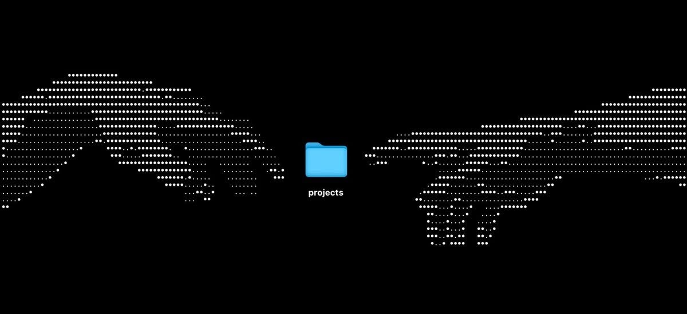

<p align="center">
  
</p>

# Hola, soy Erik 👋

Vengo del mundo de las redes. Pasé buen tiempo entre switches, routers y alertas de monitoreo, y en algún momento me di cuenta de que muchos de los problemas que veía en las empresas no eran de cables, sino de procesos: hojas de Excel que nadie entendía, cotizaciones hechas a mano, nóminas que se cuadraban a calculadora.

Así que empecé a programar para resolver eso. Hoy hago las dos cosas: **mantengo infraestructura de red y construyo sistemas a la medida** para que la gente deje de pelearse con su trabajo diario.

```
erik#show running-config
!
hostname Erik
 role         Redes e infraestructura + Desarrollo web y móvil
 location     México
 education    TSU Infraestructura y Redes Digitales
 education    Ing. Redes Inteligentes y Ciberseguridad
!
interface Redes
 description  Cisco | Huawei | Teldat | monitoreo con PRTG
 no shutdown
!
interface Desarrollo
 description  Laravel | PHP | Vue | Flutter | MySQL
 no shutdown
!
router aprendizaje
 network      Automatizacion-de-red-con-Python
 network      Linux-y-Bash
 network      Go
 network      Ciberseguridad
!
end
```

> *"La inteligencia es la habilidad de evitar hacer el trabajo, consiguiendo el trabajo hecho."*
> — Linus Torvalds

## 🧰 A qué me dedico

**Redes e infraestructura.** Trabajo con equipo Cisco, Huawei y Teldat, monitoreo con PRTG y atiendo incidentes cuando algo se cae (que siempre es en el peor momento). Documento cada falla como un runbook para que la siguiente vez se resuelva en minutos y no en horas.

**Desarrollo web y móvil.** Hago sistemas internos completos: desde la base de datos hasta la pantalla que usa la persona, y también la parte de subirlo a un servidor y que no se caiga.

## 🛠️ Algunas cosas que he construido

- **Sistema de nómina quincenal para Recursos Humanos.** Expedientes del personal con datos bancarios cifrados, captura de faltas y vacaciones en calendario según la LFT, cálculo de finiquitos, cierre de quincenas que ya no se puede alterar y reportes en Excel y PDF. *Laravel, Vue 3, TypeScript, Tailwind, MySQL, pruebas con Pest.*
- **Plataforma de gestión para una empresa de telecomunicaciones.** Cotizaciones, proyectos, inventario, herramientas, flotilla vehicular y control por roles (administración, logística y ventas), con PDFs generados al momento. *PHP puro, MySQL, JavaScript, Chart.js.*
- **App para mantenimiento de extintores.** Los técnicos escanean un QR, hacen la inspección con fotos, firma y GPS (incluso sin internet), y el cliente recibe alertas de vencimiento y reportes. *Flutter (Android, iOS y web) + API en Laravel con Sanctum.*
- **App para un rancho de engorda.** Control de animales por lote, corrales, alimento por costal, medicamentos, proveedores, saldos y abonos. *Flutter + Laravel, desplegada en cPanel.*

## 💻 Con qué trabajo

**Web**
<p align="left"></p>

**Backend y bases de datos**
<p align="left"></p>

**Móvil**
<p align="left"></p>

**Servidores y herramientas**
<p align="left"></p>


**Redes**


## 🎯 Hacia dónde voy

Quiero llegar a ser **arquitecto de soluciones con enfoque en ciberseguridad**: alguien que entienda la red, el servidor y el código lo suficiente como para diseñar sistemas que funcionen bien y que sean difíciles de romper.

Por eso ahora estoy aprendiendo a automatizar equipos de red con Python, a meterle más horas a Linux y Bash, y a darle una oportunidad a Go.

<p align="left"></p>

## 🐍 Mi actividad

<picture>
  <source media="(prefers-color-scheme: dark)" srcset="https://raw.githubusercontent.com/Arima2814/Arima2814/output/github-snake-dark.svg"/>
  
</picture>

## 🤝 Platiquemos

Si te late hablar de redes, de código, de seguridad o de cómo sacar a una empresa de sus hojas de Excel, escríbeme. Siempre hay algo nuevo que aprender de alguien más.
